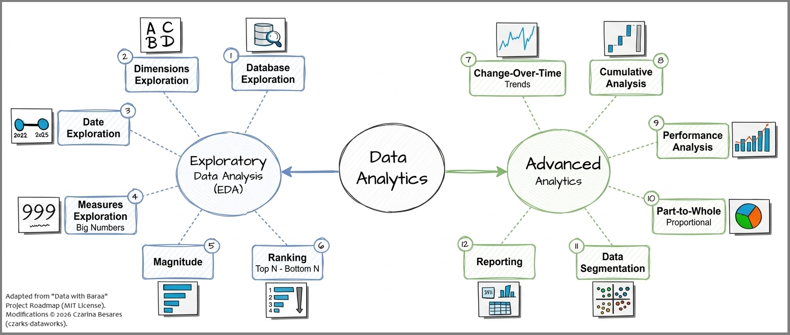
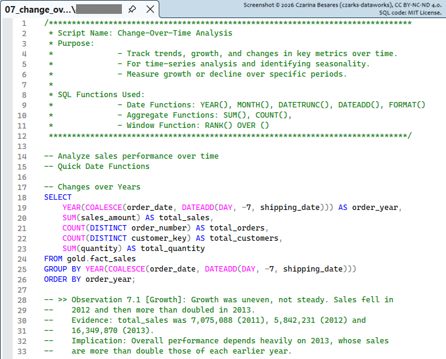
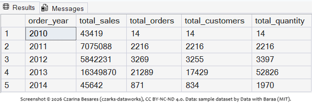
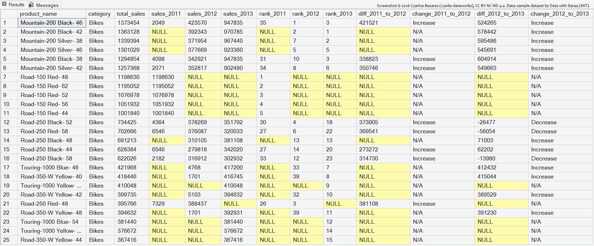
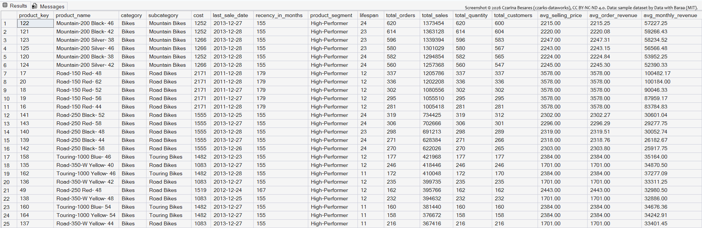

# SQL Data Analytics Project

### Table of Contents

&emsp; 📌 [Overview](#-overview) \
&emsp; 🛠️ [Skills Demonstrated](#️-skills-demonstrated) \
&emsp; 🎯 [Project Brief](#-project-brief) \
&emsp; 🏗️ [Data Pipeline Context](#️-data-pipeline-context) \
&emsp; 🛣️ [Analysis Roadmap](#️-analysis-roadmap) \
&emsp; 💻 [Output Examples](#-output-examples) \
&emsp; 📈 [Key Business Findings & Recommendations](#-key-business-findings--recommendations) \
&emsp; 🛡️ [Data Quality & Validation](#️-data-quality--validation) \
&emsp; ⚙️ [Repository & Setup Guide](#️-repository--setup-guide) \
&emsp; ✨ [Credits & Enhancements](#-credits--enhancements) \
&emsp; 📜 [License](#-license) \
&emsp; 👩🏻‍💻 [About Me](#-about-me) 

💡 **Tip:** On the GitHub repository page, you can use the **Outline** button (☰) at the top right of this README to jump to any section.

## 📌 Overview

This is an **exploratory data analysis (EDA)** and **advanced analytics reporting project** built on a retail business dataset using **Microsoft SQL Server (T-SQL)**. Analysis progresses from schema, data, and data-quality inspection to ranking, time-series, part-to-whole analysis,and segmentation, and culminates in the creation of two reusable reports designed for business intelligence (BI) use.

<div align="center">

| Dataset at a Glance | # |
| :--- | ---: |
| **👥 Customers** | 18,484 |
| **📦 Products** | 295 |
| **💰 Total sales** | 29,356,250 |
| **📅 Period covered** | Dec 2010 to Jan 2014 |

</div>

This project also answers **business questions:** business observations at various stages of the analysis were recorded in the SQL scripts, with corresponding recommendations presented in this document, summarized in [Key Business Findings & Recommendations](#-key-business-findings--recommendations).

This repository is the analytics complement to my **[SQL Data Warehouse Project](https://github.com/czarks-dataworks/sql-data-warehouse-project "Go to GitHub repository (czarks-dataworks)")** (see [Data Pipeline Context](#️-data-pipeline-context) for the flow of data) and follows the guided **[SQL Data Analytics Project by Data With Baraa](https://github.com/DataWithBaraa/sql-data-analytics-project "Go to GitHub repository")** (see [Credits & Enhancements](#-credits--enhancements) for my revisions and additions).

## 🛠️ Skills Demonstrated

T-SQL · Schema & Domain Profiling · EDA · CTEs & Modular Query Structure · Conditional Logic · Window Functions · Time-series and Cumulative Analysis · Year-Over-Year Analysis · Part-to-Whole Analysis · Customer and Product Segmentation · Reusable KPI Reporting Views · Data Quality Checks · Business Insight Writing

## 🎯 Project Brief

**Objective**

Develop BI-ready, SQL-based analytics to deliver detailed insights into:

- 🧑🏻‍🦱 Customer Behavior
- 🚲 Product Performance
- 📈 Sales Trends

**Specifications**

- **Data source:** The Gold layer of the SQL Data Warehouse Project, provided as the `DataWarehouse.bak` database backup.
- **Data quality:** Check data coverage and date quality before analysis, and document how each issue was handled.
- **Reporting:** Consolidate customer and product metrics into two reusable views designed for BI tools.
- **Documentation:** Record business observations (finding, evidence, implication) in the scripts, and summarize them in this README.

**Outputs**

- **Exploratory data analysis (EDA):** Profiling the database structure, dimensions, date ranges, and key measures, and ranking customers and products
- **Advanced analytics:** Change over time, cumulative totals, year-over-year performance, part-to-whole analysis, and segmentation
- **Reporting views:** Two reusable views that consolidate customer and product metrics for BI
- **Business insights and recommendations:** Observations arising from the analysis, evidence and implications of those observations, and resulting business recommendations

## 🏗️ Data Pipeline Context

This project sits downstream of the [SQL Data Warehouse Project (DWP)](https://github.com/czarks-dataworks/sql-data-warehouse-project "Go to GitHub repository"), which builds the data warehouse from raw CRM and ERP data following the **Medallion architecture:** Bronze, Silver, Gold. This project starts where the DWP ends:

[](docs/01_data_pipeline_context.png "View image file in this repository")

| | SQL DWP | SQL Data Analytics Project |
|---|---|---|
| **Purpose** | Build the data warehouse | Analyze the data warehouse |
| **Input** | CRM and ERP CSV files | Gold layer (star schema) from the DWP |
| **Main work** | ELT pipelines, data cleansing, dimensional modeling | EDA, advanced analytics, reporting views |
| **Output** | Gold layer (star schema) | 13 SQL scripts, including those that create 2 reporting views |
| **Database** | `DataWarehouse` | `DataWarehouse` (+2 views in the Gold layer) |

### Database Views

**Inputs: `DataWarehouse` Gold Layer (Star Schema)**

Dimension (`dim`) and fact (`fact`) tables built in the DWP:

- `gold.dim_customers`: Customer profiles and demographics (country, gender, marital status, birthdate)
- `gold.dim_products`: Product catalog (category, subcategory, cost, start date)
- `gold.fact_sales`: Transaction-level sales with order, shipping, and due dates, price, quantity, sales amount, and keys to the dimensions

**Outputs: Reporting Views Added to the `DataWarehouse` Gold Layer**

Created in this project (scripts 12 and 13):

- `gold.report_customers`: One row per customer, with age group, customer segment, recency, lifespan, average order value, and average monthly spend. Segments: **VIP** (lifespan of 12+ months and total sales above 5,000), **Regular** (lifespan of 12+ months and total sales of 5,000 or less), **New** (lifespan under 12 months)
- `gold.report_products`: One row per product, with product segment, recency, lifespan, average selling price, average order revenue, and average monthly revenue. Segments: **High-Performer** (total sales above 50,000), **Mid-Range** (10,000 to 50,000), **Low-Performer** (below 10,000)

ℹ️ **Note:** *Lifespan* is the number of months between a customer's or product's first and last order, calculated with `DATEDIFF(MONTH, ...)`. It counts month boundaries crossed, not full elapsed months, so orders on January 31 and February 1 give a lifespan of 1. When lifespan is 0, average monthly spend (customers) or revenue (products) equals total sales.

## 🛣️ Analysis Roadmap

[](docs/02_analytics_roadmap_adapted.png "View image file in this repository") 
*Source: Data With Baraa, with modifications*

The diagram above presents the project roadmap from the course, with minor modifications for this repository: EDA placed on the left and Advanced Analytics on the right (view original diagram [here](docs/03_original_project_roadmap_by_data_with_baraa.png)). The table below outlines the analysis sequence, scripts, and key techniques used following the roadmap. Step 12 (Reporting) under Advanced Analytics covers the preparation of both scripts 12 and 13.

| Part | Script | Focus | Key techniques |
|------|--------|-------|----------------|
| **EDA** | `01_database_exploration.sql` | Database structure and column metadata | `INFORMATION_SCHEMA` |
| | `02_dimensions_exploration.sql` | Dimension values and product hierarchy | `DISTINCT` |
| | `03_date_range_exploration.sql` | Date coverage, customer ages, NULL order dates | `MIN`, `MAX`, `DATEDIFF`, CTEs |
| | `04_measures_exploration.sql` | Key business metrics | `SUM`, `COUNT`, `AVG`, `UNION ALL` |
| | `05_magnitude_analysis.sql` | Totals by dimension | `GROUP BY`, `ROLLUP` |
| | `06_ranking_analysis.sql` | Top and bottom products and customers | `TOP`, `RANK()` |
| **Advanced Analytics** | `07_change_over_time_analysis.sql` | Trends and seasonality | `DATETRUNC`, `FORMAT`, `RANK()` |
| | `08_cumulative_analysis.sql` | Running totals and moving averages | `SUM() OVER`, `AVG() OVER` |
| | `09_performance_analysis.sql` | Year-over-year product performance | `LAG()`, conditional aggregation |
| | `10_part_to_whole_analysis.sql` | Category contribution to total sales | `SUM() OVER ()` |
| | `11_data_segmentation.sql` | Product cost ranges and customer segments | `CASE` |
| | `12_report_customers.sql` | Customer report view | CTEs, segmentation, KPIs |
| | `13_report_products.sql` | Product report view | CTEs, segmentation, KPIs |

<p align="right"><a href="#sql-data-analytics-project">↑ Back to top</a></p>

## 💻 Output Examples

🔔 **Reminder:** SQL scripts can only run correctly after the **[full setup](#️-repository-structure--setup-guide)** is completed.

<details>
<summary><strong>A. Script 07 - Change-over-Time analysis (screenshots of SSMS)</strong> - <i>click to expand</i></summary>

[](scripts/07_change_over_time_analysis.sql "View full SQL script")

</details>

**Results:**



Each script has a header that presents the script name, purpose, and SQL functions used. Queries in the script are also labeled on top to describe their results. Observations (based on the results, when the query is executed) are numbered and provided with evidence and implication. 

<details>
<summary><strong>B. Script 09 - Performance Analysis (second query)</strong> - <i>click to expand</i></summary>

```sql
WITH yearly_sales AS (
    SELECT
        p.product_name,
        p.category,
        YEAR(COALESCE(f.order_date, DATEADD(DAY, -7, f.shipping_date))) AS order_year,
        SUM(f.sales_amount) AS total_sales
    FROM gold.fact_sales f
    LEFT JOIN gold.dim_products p
           ON f.product_key = p.product_key
    WHERE YEAR(COALESCE(f.order_date, DATEADD(DAY, -7, f.shipping_date)))
          BETWEEN 2011 AND 2013
    GROUP BY
        p.product_name,
        p.category,
        YEAR(COALESCE(f.order_date, DATEADD(DAY, -7, f.shipping_date)))
)
, pivoted AS (
    SELECT
        product_name,
        category,
        SUM(total_sales) AS total_sales,
        SUM(CASE WHEN order_year = 2011 THEN total_sales END) AS sales_2011,
        SUM(CASE WHEN order_year = 2012 THEN total_sales END) AS sales_2012,
        SUM(CASE WHEN order_year = 2013 THEN total_sales END) AS sales_2013
    FROM yearly_sales
    GROUP BY product_name, category
)
, product_ranks_and_changes AS (
SELECT
    product_name,
    category,
    total_sales,
    sales_2011,
    sales_2012,
    sales_2013,
    CASE WHEN sales_2011 IS NULL THEN NULL
         ELSE RANK() OVER (ORDER BY sales_2011 DESC) END AS rank_2011,
    CASE WHEN sales_2012 IS NULL THEN NULL
         ELSE RANK() OVER (ORDER BY sales_2012 DESC) END AS rank_2012,
    CASE WHEN sales_2013 IS NULL THEN NULL
         ELSE RANK() OVER (ORDER BY sales_2013 DESC) END AS rank_2013,
    sales_2012 - sales_2011 AS diff_2011_to_2012,
    CASE
        WHEN sales_2011 IS NULL OR sales_2012 IS NULL THEN 'N/A'
        WHEN sales_2012 > sales_2011 THEN 'Increase'
        WHEN sales_2012 < sales_2011 THEN 'Decrease'
        ELSE 'No Change'
    END AS change_2011_to_2012,
    sales_2013 - sales_2012 AS diff_2012_to_2013,
    CASE
        WHEN sales_2012 IS NULL OR sales_2013 IS NULL THEN 'N/A'
        WHEN sales_2013 > sales_2012 THEN 'Increase'
        WHEN sales_2013 < sales_2012 THEN 'Decrease'
        ELSE 'No Change'
    END AS change_2012_to_2013
FROM pivoted
)
SELECT TOP 25
*
FROM product_ranks_and_changes
-- Customize WHERE clause to show years and rankings of interest.
-- Example: To show the 5 top-selling products per year:
-- WHERE rank_2011 <= 5 OR rank_2012 <= 5 OR rank_2013 <= 5
ORDER BY total_sales DESC;
```
ℹ️ **Note:** "TOP 25" was added in the script for this example. In the actual script, all rows from `product_ranks_and_changes` are selected.

</details>

**Results:**

[](docs/05_performance_analysis_pivot_top25.png "View image file in this repository")

Product sales by year (2011-2013) with annual sales ranking (`rank_20...` columns) and year-over-year increase/decrease flags (`change_20...` columns). Uses conditional aggregation [`SUM(CASE...WHEN ...)`] to turn each sales year into a column, producing pivot table-like results. A NULL in a year column means the product had no sales that year. Ranks are NULL for years with no sales.

ℹ️ **Note:** This is one of the [extensions](#extensions "Go to subsection in this README") of this project, i.e. the query is my addition and is not included in the guided project.

<details>
<summary><strong>C. Script 13 - Product Report</strong><i> - click to expand</i></summary>

```sql
--------------------------------------------------------------------------------
-- Create Report: gold.report_products
--------------------------------------------------------------------------------
IF OBJECT_ID('gold.report_products', 'V') IS NOT NULL
    DROP VIEW gold.report_products;
GO

CREATE VIEW gold.report_products AS

WITH base_query AS (
--------------------------------------------------------------------------------
-- 1. Base Query: Retrieves core columns from fact_sales and dim_products
--------------------------------------------------------------------------------
    SELECT
        f.order_number,
        COALESCE(order_date, DATEADD(DAY, -7, shipping_date)) AS order_date,
        f.customer_key,
        f.sales_amount,
        f.quantity,
        p.product_key,
        p.product_name,
        p.category,
        p.subcategory,
        p.cost
    FROM gold.fact_sales f
    LEFT JOIN gold.dim_products p
        ON f.product_key = p.product_key
),
product_aggregations AS (
--------------------------------------------------------------------------------
-- 2. Product Aggregations: Summarizes key metrics at the product level
--------------------------------------------------------------------------------
SELECT
    product_key,
    product_name,
    category,
    subcategory,
    cost,
    DATEDIFF(MONTH, MIN(order_date), MAX(order_date)) AS lifespan,
    MAX(order_date) AS last_sale_date,
    COUNT(DISTINCT order_number) AS total_orders,
    COUNT(DISTINCT customer_key) AS total_customers,
    SUM(sales_amount) AS total_sales,
    SUM(quantity) AS total_quantity,
	CAST(1.0 * AVG(sales_amount / NULLIF(quantity, 0)) AS DECIMAL(18, 2))
        AS avg_selling_price
FROM base_query
GROUP BY
    product_key,
    product_name,
    category,
    subcategory,
    cost
)
--------------------------------------------------------------------------------
-- 3. Final Query: Combines all of the above information into one output
--------------------------------------------------------------------------------
SELECT 
    product_key,
    product_name,
    category,
    subcategory,
    cost,
    last_sale_date,
    DATEDIFF(MONTH, last_sale_date, GETDATE()) AS recency_in_months,
    CASE
        WHEN total_sales > 50000 THEN 'High-Performer'
        WHEN total_sales >= 10000 THEN 'Mid-Range'
        ELSE 'Low-Performer'
    END AS product_segment,
    lifespan,
    total_orders,
    total_sales,
    total_quantity,
    total_customers,
    avg_selling_price,
    -- Average Order Revenue (AOR)
    CASE 
        WHEN total_orders = 0 THEN 0
        ELSE CAST(1.0 * total_sales / total_orders AS DECIMAL(18, 2))
    END AS avg_order_revenue,
    -- Average Monthly Revenue
    CASE
        WHEN lifespan = 0 THEN total_sales
        ELSE CAST(1.0 * total_sales / lifespan AS DECIMAL(18, 2))
    END AS avg_monthly_revenue
FROM product_aggregations;
```

</details>

After creation, query the **`gold.report_products`** view:
```sql
SELECT TOP 25 *
FROM gold.report_products
ORDER BY total_sales DESC;
```

**Results:**

[](docs/06_report_products_top25.png "View image file in this repository")

Together with the Customer Report, the Product Report is the culmination of this project: it is a view object in the database, designed for use by other BI professionals in the organization. The report gathers all essential fields about the product, provides product segmentation by revenue, and calculates key performance indicators (KPIs) using aggregated product-level metrics and business rules.

ℹ️ **Note:** Figures in the Customer and Product Reports include 2010 and 2014.

<p align="right"><a href="#sql-data-analytics-project">↑ Back to top</a></p>

## 📈 Key Business Findings & Recommendations

> **Caveat:** Because this project centers on exploratory and advanced SQL analytics—and the guided project calls for high-level business insights rather than full operational diagnostics—these findings highlight clear patterns and initial leads rather than final root causes. Confirming exact drivers and alternative business explanations will require a deeper examination of the data, together with operational and stakeholder context.

**Overall assessment.** Across the three full years in the data (2011 to 2013), sales grew strongly but unevenly: they fell in 2012 and then more than doubled in 2013 – that year's total alone exceeded all earlier years combined. Revenue is concentrated in one category (Bikes) and in a rotating set of model lines, and most customers have a purchase history of less than 12 months. The business shows strong growth, but it depends heavily on a single category, a few leading models, and one strong year.

Each finding below is supported by observations in the SQL scripts, written in the format *observation, evidence, implication*. The evidence (figures and query results) is in the referenced script, appearing after the query that produced it.

### Key Business Findings

1. **Revenue is concentrated in one category**

    - **Finding:** Bikes account for about 96% of total sales. Accessories and Clothing together contribute about 3.5%, and Accessories contribute more than twice as much as Clothing. Bikes were the only category sold until 2012; Accessories and Clothing grew quickly after they first appeared, but from very small bases. Separately, by product count the catalog is weighted toward low-cost items.
    - **Business implication:** Performance is driven almost entirely by Bikes. Neither of the smaller categories materially offsets that dependence, even after their rapid growth in 2013.
    - **Evidence:** `10_part_to_whole_analysis.sql` (Observations 10.1 and 10.2), `07_change_over_time_analysis.sql` (Observations 7.3 and 7.5), `11_data_segmentation.sql` (Observation 11.1).

2. **Growth was uneven and driven by 2013**

    - **Finding:** Sales fell in 2012 and then more than doubled in 2013. The 2012 dip came from the Bikes category itself. 2013 sales were higher than 2012 in every month, so the growth was spread across the year, and the 2013 sales alone exceeded the combined sales of all earlier years.
    - **Business implication:** Overall results depend heavily on 2013. With only three full years of data, growth statements should be treated as indicative, not as an established trend.
    - **Evidence:** `07_change_over_time_analysis.sql` (Observations 7.1, 7.4, and 7.10), `08_cumulative_analysis.sql` (Observations 8.1 and 8.2).

3. **The 2012 dip came from lower revenue per customer and a changing product mix, not from lost customers**

    - **Finding:** Customers and orders grew every year, including 2012, so each customer and each order brought in less revenue. No product with sales in both 2011 and 2012 declined, but several of the highest-selling 2011 models (the Road-150 Red and Mountain-100 models) have no sales after 2011, and the top 2012 models sold far less than the top 2011 models.
    - **Business implication:** The dip is consistent with top-selling models leaving the range, not with declines in continuing products or a shrinking customer base.
    - **Evidence:** `07_change_over_time_analysis.sql` (Observation 7.2), `09_performance_analysis.sql` (Observations 9.1, 9.2, 9.5, and 9.6).

4. **Product leadership rotates between model lines**

    - **Finding:** The top sellers change by year: Road-150 Red models in 2011, Mountain-200 and Road-250 models in 2012, and Mountain-200 models in the top six places in 2013. The same Mountain-200 models also lead total sales over the whole period and scaled from little or no sales in 2011 to the top ranks within two years. Nearly every product with sales in both 2012 and 2013 increased (three Road-250 models declined), but the largest increases came from Mountain-200 models.
    - **Business implication:** Performance depends on whichever model line is currently leading, so the rebound in 2013 rested on one line more than on the whole range.
    - **Evidence:** `09_performance_analysis.sql` (Observations 9.3, 9.7, 9.8, 9.9, and 9.10), `13_report_products.sql` (Observation 13.1).

5. **Order volume does not translate into revenue**

    - **Finding:** The most-ordered product, the 30 oz. water bottle, has a very low total sales figure. In early 2013, orders and units more than doubled from January to February while sales fell. The running average of yearly average prices fell steadily after 2011.
    - **Business implication:** Order counts do not track sales, so sales is the better measure of growth. Low-priced accessories raise order counts without contributing much revenue, and the growth did not come from higher average prices.
    - **Evidence:** `13_report_products.sql` (Observation 13.2), `07_change_over_time_analysis.sql` (Observation 7.11), `08_cumulative_analysis.sql` (Observation 8.3).

6. **Most customers are new, and spend does not follow order frequency**

    - **Finding:** Most customers have a lifespan of less than 12 months (the New segment), and VIPs are the smallest group. The highest-spending customers are VIPs with only a few orders each, while the most frequent buyers spend far less and can still be classified as New.
    - **Business implication:** Top customer spend comes from a small number of high-value orders, not from frequent purchasing. Because segments depend on lifespan and total sales, order frequency alone does not identify high-value customers.
    - **Evidence:** `11_data_segmentation.sql` (Observation 11.2), `12_report_customers.sql` (Observations 12.1 and 12.2).

7. **Demand appears seasonal, with limited history to confirm it**

    - **Finding:** Pooled across 2011 to 2013, December is the highest sales month and February the lowest. November, June, and October follow December, and January to March are the weakest months. The pattern is consistent in most years but not all: December ranked third in 2011, and February ranked sixth in 2012.
    - **Business implication:** December strength and a slow start to the year are likely patterns, but three years of data are too few to treat them as established. The pooled ranking is also weighted toward 2013, the largest year, and sales grew within 2013 itself (January 857,758 vs December 1,874,128), so part of the December high and early-year low may reflect growth rather than seasonality.
    - **Evidence:** `07_change_over_time_analysis.sql` (Observations 7.7, 7.8, and 7.10).

### Business & Data Analysis Recommendations

1. **Reduce dependence on Bikes.** Set growth targets for Accessories and Clothing and track their share of sales over time. Both scaled quickly in 2013, so there is a base to build on. *(Finding 1)*

2. **Plan for model-line turnover.** Sales leadership rotates between model lines, and some top 2011 models have no sales afterward. Monitor the performance of leading lines such as Mountain-200, and plan replacements before a leading line fades. *(Findings 3 and 4)*

3. **Prepare for seasonal demand, but confirm the pattern first.** December is the strongest month and early-year months are the weakest. Plan inventory and promotions around this, but wait for more years of data before making large commitments. *(Finding 7)*

4. **Measure growth by sales and revenue per customer, not by counts.** Order and customer counts grew in 2012 while sales fell, and orders more than doubled from January to February 2013 while sales fell. Track sales, revenue per customer, and revenue per order as the main growth indicators. *(Findings 3 and 5)*

5. **Identify high-value customers by spend and tenure, not order frequency.** The top spenders place few, high-value orders, and the most frequent buyers spend far less. Use total sales and lifespan to find high-value customers, and look at what could move the large New segment toward Regular or VIP. *(Finding 6)*

6. **Avoid projecting 2013 growth forward.** Overall results depend heavily on 2013, and only three full years are available. Treat 2013 as one strong year, not as a trend, in forecasts and targets. *(Finding 2)*

<p align="right"><a href="#sql-data-analytics-project">↑ Back to top</a></p>

## 🛡️ Data Quality & Validation

Data coverage and date quality are examined in `03_date_range_exploration.sql` before the analysis begins. Reconciliation checks in `04_measures_exploration.sql` and `11_data_segmentation.sql` confirm that:

- All customers in `gold.dim_customers` have at least one order.
- Product cost-range counts add up to the total number of products (295).
- Customer segment counts add up to the total number of customers (18,484).

### Issues Found & Handled

| Issue | Where | Handling |
|-------|-------|----------|
| 19 sales rows (15 orders) have a NULL order_date. The guided scripts either filter them out or ignore their dates. | `gold.fact_sales` | Order date set to `COALESCE(order_date, DATEADD(DAY, -7, shipping_date))` in all scripts, since every dated order ships exactly 7 days after it is placed. Confirmed by dated rows of the same order for 13 of 15 affected orders; the other 2 (3 rows) rely on the pattern. Evidence: [script 03](scripts/03_date_range_exploration.sql), Observations 3.4 to 3.6. |
| Partial years. 2010 holds only December 29 to 31, and 2014 only January 1 to 28. | `gold.fact_sales` | Seasonality and the pivot-style year-over-year comparison use 2011 to 2013 only. Other yearly and cumulative queries include 2010 and 2014, and conclusions about trend and growth rely on 2011 to 2013. |
| Bikes have sales before their recorded start date (in 2010 and in the first half of 2011; the earliest Bikes `start_date` is July 1, 2011). | `gold.fact_sales`, `gold.dim_products` | Flagged, not corrected. Either the sales records are overstated or `start_date` does not mark when a product was launched or first sold. Bike figures before July 2011 are treated with caution. 2010 is already excluded from trend analysis, but 2011, the baseline for growth comparisons, includes affected months. Evidence: [script 07](scripts/07_change_over_time_analysis.sql), Observation 7.3.1. |
| Oldest customer is over 100 years old (birthdate 1916-02-10). | `gold.dim_customers` | Flagged. Age-based analysis should treat this birthdate with caution. |

## ⚙️ Repository & Setup Guide

### Repository Structure

```
sql-data-analytics-project/
├── datasets/                            # Database backup (DataWarehouse.bak)
├── docs/                                # Diagrams and other project references
├── scripts/                             # SQL analysis scripts
│   ├── 01_database_exploration.sql
│   ├── 02_dimensions_exploration.sql
│   ├── 03_date_range_exploration.sql
│   ├── 04_measures_exploration.sql
│   ├── 05_magnitude_analysis.sql
│   ├── 06_ranking_analysis.sql
│   ├── 07_change_over_time_analysis.sql
│   ├── 08_cumulative_analysis.sql
│   ├── 09_performance_analysis.sql
│   ├── 10_part_to_whole_analysis.sql
│   ├── 11_data_segmentation.sql
│   ├── 12_report_customers.sql
│   └── 13_report_products.sql
├── .gitignore
├── LICENSE
└── README.md
```

### Prerequisites

Make sure the following are installed and working on your computer:

- **Database:** [SQL Server 2022 Express](https://www.microsoft.com/en-us/sql-server/sql-server-downloads "Go to download page") (or later versions)
- **Client tool:** [SQL Server Management Studio (SSMS)](https://learn.microsoft.com/en-us/sql/ssms/download-sql-server-management-studio-ssms "Go to download page")

### Step-by-Step Setup

1. **Clone the repository**
   ```
   git clone https://github.com/czarks-dataworks/sql-data-analytics-project.git
   cd sql-data-analytics-project
   ```
2. **Restore the database**

   > ⚠️ **Notice:** If you already have the `DataWarehouse` database from the SQL Data Warehouse Project, skip this step.

   a. Copy `DataWarehouse.bak` from the [`datasets/`](datasets/) folder to your SQL Server backup location, typically `C:\Program Files\Microsoft SQL Server\MSSQL16.SQLEXPRESS\MSSQL\Backup`.

   b. In SSMS, right-click `Databases` → `Restore Database...`.

   c. Under Source, select `Device` → Click `...` → `Add` → Pick the `.bak` file → Click `OK` twice.

3. **Run the EDA scripts.** Run `scripts/01_` to `scripts/06_` against the `DataWarehouse` database. Each script contains several independent queries, so you can run them one at a time or all together.
4. **Run the advanced analytics scripts.** Run `scripts/07_` to `scripts/11_`. Scripts 07 and 08 use `DATETRUNC()`, which requires SQL Server 2022 or a later version.
5. **Create the reporting views.** Run `scripts/12_report_customers.sql` and `scripts/13_report_products.sql`. Each script drops and recreates its view. Verify the output:

   ```sql
   SELECT TOP 10 * FROM gold.report_customers;
   SELECT TOP 10 * FROM gold.report_products;
   ```

    ℹ️ **Note:** Ages and recency are calculated from the date you run the scripts, so these values will differ from the figures in the observations over time.

<p align="right"><a href="#sql-data-analytics-project">↑ Back to top</a></p>

## ✨ Credits & Enhancements

[](https://github.com/DataWithBaraa/sql-data-analytics-project "Go to GitHub repository")

This project follows the guided [SQL Data Analytics Project](https://github.com/DataWithBaraa/sql-data-analytics-project "Go to GitHub repository") from the [Data With Baraa SQL course](https://www.youtube.com/watch?v=6cJ5Ji8zSDg "Go to guided project on YouTube"), which provides the datasets and the overall design. As this was a learning exercise, I followed the business rules given in the course and applied my own business logic where they were silent.

This repository contains revised versions of the guided SQL scripts. Beyond clarifying inline comments, the revisions address logic and edge-case issues, refine date sorting and decimal formatting, and add extra analytical queries, reconciliation checks, and structured business observations.

All images inside `docs/` are mine except for the original project roadmap and the adapted version.

The tables below group the revisions into **corrections**, **refinements**, and **additions**, based on their effect on the guided scripts.

### Corrections

*Fix errors in the guided version that produced wrong results or misleading output, such as faulty logic, overlapping ranges, syntax slips, and inaccurate comments*

| Script | Issue in the guided version | Revision |
|--------|-----------------------------|----------|
| [03](scripts/03_date_range_exploration.sql), [12](scripts/12_report_customers.sql) | Age was computed with `DATEDIFF(YEAR)` alone, which counts year boundaries and overstates age by 1 until the birthday has passed | Age is calculated as completed years; February 29 birthdates (edge cases) are also handled in both scripts |
| [08](scripts/08_cumulative_analysis.sql) | The comment described monthly totals, but the query is yearly | Comment corrected to per year |
| [11](scripts/11_data_segmentation.sql) | Cost ranges overlapped at 500 and 1000 (`BETWEEN 100 AND 500`, `BETWEEN 500 AND 1000`) | Ranges are mutually exclusive (lower bound included, upper bound excluded), and labels were updated to match |
| [12](scripts/12_report_customers.sql) | A missing comma after `total_products` turned it into an alias named `lifespan`, so the real `lifespan` column was missing from the output and `total_products` was mislabeled | Comma restored, so both columns appear correctly |
| [12](scripts/12_report_customers.sql) | Customers without a birthdate fell into the `50 and above` age group | They are now grouped as `Unknown` |

### Refinements

*Leave the original logic intact but improve how results are sorted, labeled, numbered, or formatted*

| Script | Issue in the guided version | Revision |
|--------|-----------------------------|----------|
| [07](scripts/07_change_over_time_analysis.sql) | Month labels from `FORMAT(order_date, 'yyyy-MMM')` were sorted alphabetically (2011-Apr, 2011-Aug, 2011-Dec, and so on) | Results are grouped and sorted by `DATETRUNC(MONTH, ...)` so that rows appear chronologically |
| [08](scripts/08_cumulative_analysis.sql) | Prices were averaged without decimal handling | Prices are cast to `DECIMAL(18, 2)` so averages keep their decimals |
| [09](scripts/09_performance_analysis.sql) | A product's first year was labeled `No Change` because there is no previous year to compare with | First-year rows are labeled `N/A (First Year)` |
| [10](scripts/10_part_to_whole_analysis.sql), [11](scripts/11_data_segmentation.sql) | Part-to-whole analysis is script 11 and data segmentation is script 10 in the guided project's scripts, the reverse of the discussion order in the tutorial video and in the original project roadmap | Scripts renumbered to match discussion order |
| [12](scripts/12_report_customers.sql), [13](scripts/13_report_products.sql) | Averages (order value, monthly spend, order revenue, monthly revenue) were divided without decimal handling | Calculated with `1.0 *` and cast to `DECIMAL(18, 2)` |

### Extensions

*Add new material the guided version did not include: extra queries, reconciliation checks, and business observations*

| Script | Addition |
|--------|----------|
| [03](scripts/03_date_range_exploration.sql), [07](scripts/07_change_over_time_analysis.sql) to [13](scripts/13_report_products.sql) | Business observations in the comments (finding, evidence, implication, tagged by theme), which feed the [Key Business Findings & Recommendations](#-key-business-findings--recommendations) in this document|
| [01](scripts/01_database_exploration.sql) | Column metadata for `dim_products` and `fact_sales`, and a query for all columns of all tables |
| [02](scripts/02_dimensions_exploration.sql) | Distinct values for marital status and gender, the earliest start date per category, and a category and subcategory overview |
| [03](scripts/03_date_range_exploration.sql) | Date range per year, and a follow-up investigation of the NULL `order_date` rows (days from order to shipping, and whether affected orders have other dated rows) that supports the handling in [Data Quality & Validation](#️-data-quality--validation) |
| [05](scripts/05_magnitude_analysis.sql) | Total customers by country with a grand total (`ROLLUP`), customers, orders, and sales by gender, and sales by country and gender |
| [06](scripts/06_ranking_analysis.sql) | A CTE version of the ranking query, and subcategory added to the product rankings |
| [07](scripts/07_change_over_time_analysis.sql) | Yearly summary including order counts, sales by year and category, month-of-year seasonality ranked across full years only (2011 to 2013), and a per-year seasonality check |
| [08](scripts/08_cumulative_analysis.sql) | A single-query alternative to the subquery version |
| [09](scripts/09_performance_analysis.sql) | Category column added to the yearly product query, and a pivot-style product table for 2011 to 2013 with sales by year, yearly ranks, and year-over-year change flags (conditional aggregation) |
| [11](scripts/11_data_segmentation.sql) | Reconciliation checks: product counts add up to 295, and customer segments add up to 18,484 after confirming that all customers have purchases |

## 📜 License

This project is licensed under the [MIT License](LICENSE). The original copyright notice from the source project is retained alongside mine.

## 👩🏻‍💻 About Me

I am **Czarks**, an analytics professional with over a decade of experience in banking, finance, and government, turning messy data into decisions people trust. I am exploring **analytics engineering** and expanding my toolkit to include modern data tools.

- **GitHub:** [@czarks-dataworks](https://github.com/czarks-dataworks)
- **LinkedIn:** [Czarina Besares](https://www.linkedin.com/in/czarinabesares/)

Feel free to connect, or drop a star ⭐ if you found this project helpful.

<p align="right"><a href="#sql-data-analytics-project">↑ Back to top</a></p>